# Diagrammes Mermaid — architecture cible v0.1

Ces onze vues décrivent les contrats prévus ; elles ne représentent pas un système déjà implémenté. Noms identiques au SERVICE_CATALOG, ports et routes dans DATA_FLOWS et OpenAPI. Les fichiers `.mmd` voisins sont extraits de ce document pour rendu ultérieur.

## 1. Architecture globale

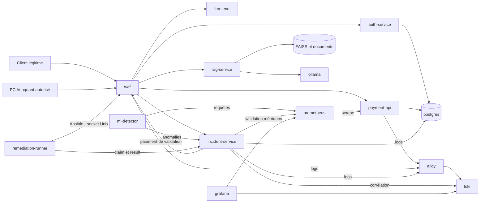

## 2. Composants du moteur

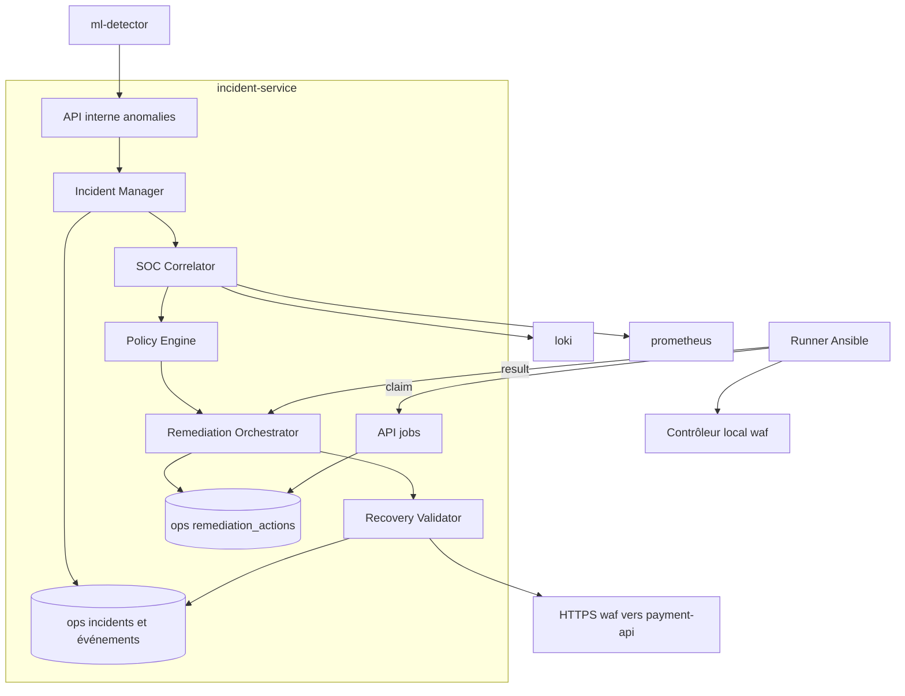

## 3. Déploiement

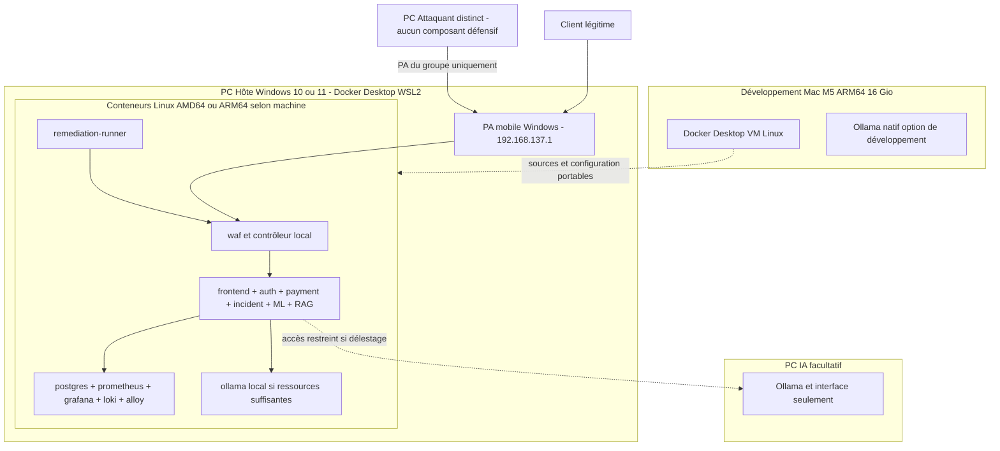

## 4. Flux réseau

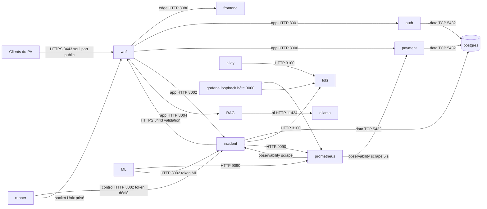

## 5. Paiement

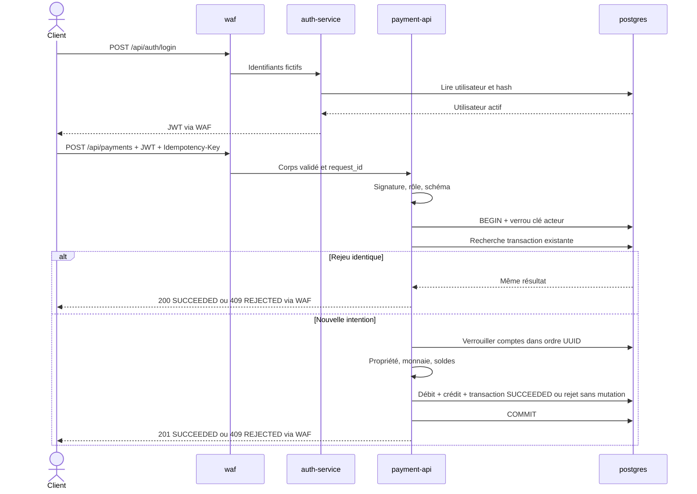

## 6. Incident

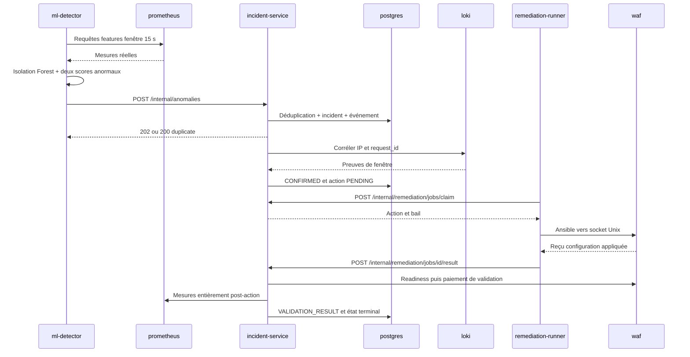

## 7. Remédiation automatique

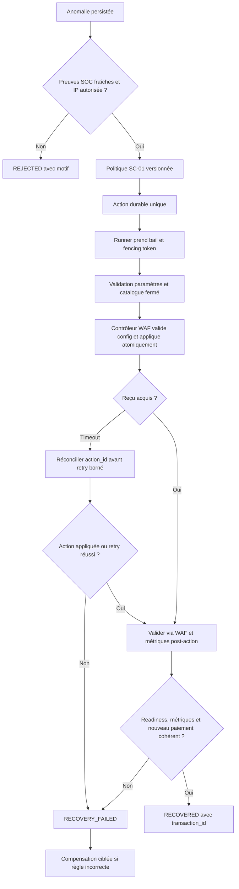

## 8. Machine à états des incidents

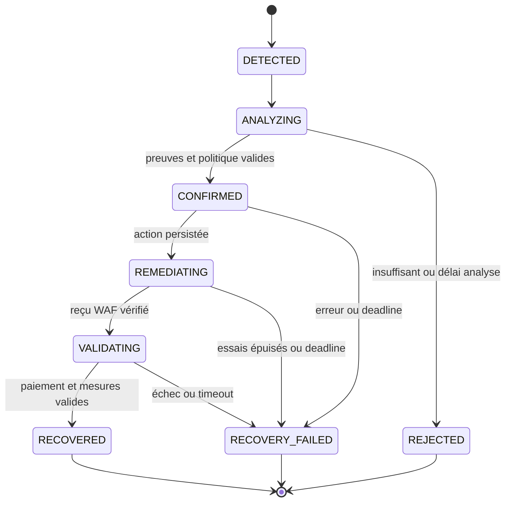

## 9. Pipeline ML

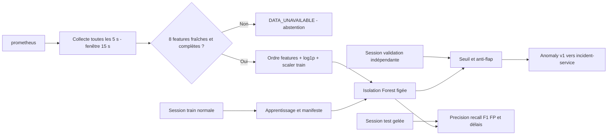

## 10. Système RAG

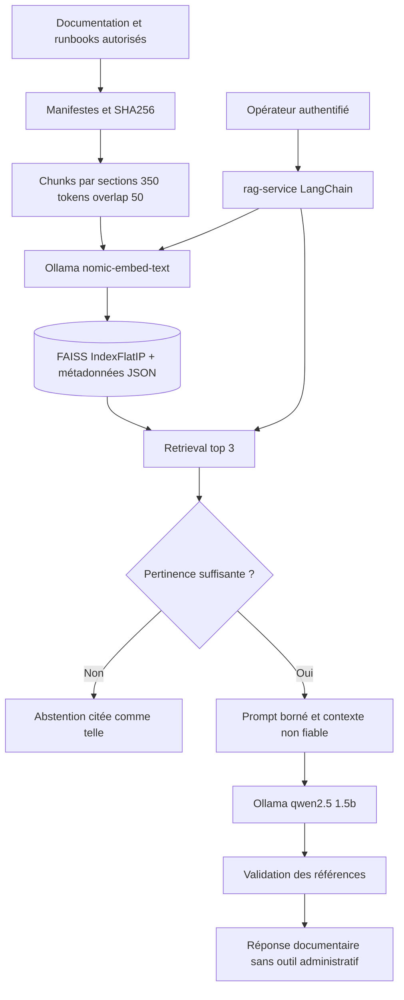

## 11. Entité-relation

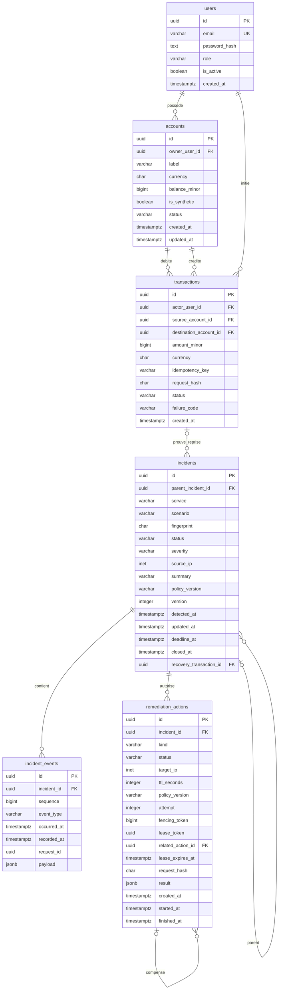
